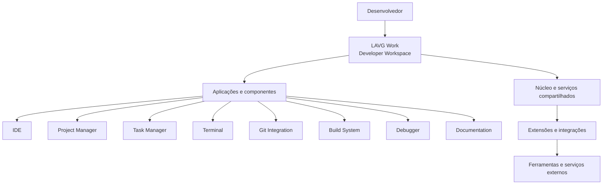
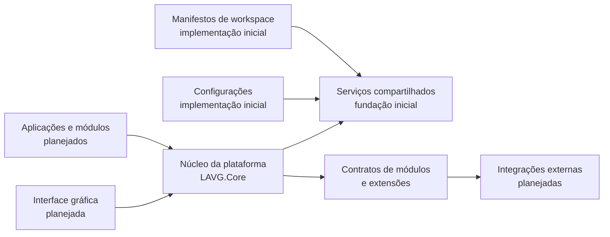

# LAVG Work

## Sumário

- [O que é o LAVG Work?](#o-que-é-o-lavg-work)
- [Visão e filosofia](#visão-e-filosofia)
- [Objetivos do projeto](#objetivos-do-projeto)
- [O conceito de Developer Workspace](#o-conceito-de-developer-workspace)
- [Componentes e aplicações](#componentes-e-aplicações)
- [Arquitetura](#arquitetura)
- [Tecnologias utilizadas](#tecnologias-utilizadas)
- [Sistemas operacionais e plataformas](#sistemas-operacionais-e-plataformas)
- [Linguagens e ecossistemas](#linguagens-e-ecossistemas)
- [Núcleo e modularidade](#núcleo-e-modularidade)
- [Extensibilidade](#extensibilidade)
- [Estado atual do desenvolvimento](#estado-atual-do-desenvolvimento)
- [Roadmap](#roadmap)
- [Estrutura do repositório](#estrutura-do-repositório)
- [Princípios de desenvolvimento](#princípios-de-desenvolvimento)
- [Contribuição](#contribuição)
- [Licença](#licença)

**LAVG Work é um Developer Workspace:** um ambiente integrado, modular e extensível para reunir ferramentas, aplicações e serviços usados no trabalho de desenvolvimento de software.

A visão do produto abrange mais do que edição de código. Ela inclui gerenciamento de projetos e tarefas, controle de versão, execução e compilação, depuração, documentação, ferramentas de desenvolvimento e extensões. Esses recursos representam a direção do projeto; o estado atual do repositório é descrito separadamente abaixo.

> **Estado observado:** a árvore remota de `main` consultada durante esta análise contém `LICENSE`, `README.md` e `Test.txt`. A solução .NET e o código C# descritos abaixo existem somente na cópia local e estão sem rastreamento pelo Git; por isso, os recursos atribuídos a eles ainda não estão publicados nessa branch.

> A IDE é um componente planejado do LAVG Work. Ela não define o produto inteiro.

## O que é o LAVG Work?

O LAVG Work pretende oferecer um espaço de trabalho unificado no qual desenvolvedores possam organizar projetos e acessar ferramentas relacionadas ao ciclo de desenvolvimento sem depender de aplicações completamente isoladas para cada atividade.

O workspace é concebido como uma plataforma de integração: seus componentes podem evoluir de forma independente e colaborar por meio de serviços e contratos compartilhados. A proposta não exige que todas as ferramentas sejam implementadas dentro de um único executável ou módulo.

## Visão e filosofia

O projeto busca reduzir a fragmentação do trabalho de desenvolvimento e estabelecer uma base que possa receber novos componentes ao longo do tempo. A arquitetura deverá equilibrar integração com independência entre módulos, evitando dependências desnecessárias no núcleo.

Os princípios orientadores são:

- **Modularidade e extensibilidade:** permitir a evolução por componentes e integrações.
- **Baixo acoplamento:** manter responsabilidades claras e limitar dependências entre áreas.
- **Manutenibilidade e organização:** favorecer uma base compreensível à medida que o produto cresce.
- **Escalabilidade:** acomodar novas ferramentas e fluxos de trabalho.
- **Desempenho:** considerar o custo dos serviços e da experiência integrada.
- **Compatibilidade multiplataforma:** planejar diferenças de capacidades entre sistemas e dispositivos.
- **Integração:** conectar ferramentas sem exigir que todas tenham a mesma implementação interna.

## Objetivos do projeto

A visão de longo prazo é consolidar uma fundação confiável para um workspace que reúna atividades do cotidiano de desenvolvimento: organizar projetos e tarefas, trabalhar com código, executar ferramentas, acompanhar alterações, compilar, depurar e consultar documentação. O projeto também pretende permitir integrações com diferentes linguagens e ecossistemas e adaptar seus componentes às plataformas suportadas.

Esses objetivos descrevem a direção do produto; não significam que as funcionalidades já estejam disponíveis.

## O conceito de Developer Workspace

Um Developer Workspace coordena diferentes aplicações, ferramentas e serviços em torno do trabalho de desenvolvimento. No LAVG Work, a IDE é uma dessas aplicações. O núcleo deverá fornecer fundamentos compartilhados, enquanto cada componente poderá oferecer uma experiência própria e integrar serviços externos quando adequado.



O diagrama representa a visão funcional do produto, não a composição de uma aplicação já implementada.

## Componentes e aplicações

A tabela distingue a fundação observável no código local dos componentes que fazem parte da visão do produto. “Planejado” significa que não foi encontrada implementação correspondente nos arquivos examinados. Nenhum componente adicional foi identificado como estando em desenvolvimento com evidência verificável no repositório.

| Componente | Estado observado | Escopo previsto |
| --- | --- | --- |
| Núcleo (`LAVG.Core`) | Implementação inicial presente localmente | Hospedagem de módulos, configurações, manifestos de workspace e contratos básicos de extensões. |
| Project Manager / workspaces | Implementação inicial presente localmente | Criar e abrir workspaces por manifesto JSON e registrar projetos dentro da raiz do workspace. Ainda não há uma aplicação de gerenciamento de projetos. |
| Gerenciamento de configurações | Implementação inicial presente localmente | Armazenar e recuperar valores tipados em JSON. |
| Extensibilidade | Contratos e catálogo inicial presentes localmente | Carregar e descarregar instâncias de extensões já fornecidas em processo. Não há evidência de descoberta, instalação ou distribuição de extensões. |
| IDE | Planejado | Edição de código, arquivos, navegação e possíveis integrações com LSP. |
| Task Manager | Planejado | Criar, relacionar e acompanhar tarefas de desenvolvimento. |
| Terminal | Planejado | Executar comandos, scripts, toolchains e processos de build. |
| Git Integration | Planejado | Acompanhar alterações, visualizar diferenças e executar operações de controle de versão. |
| Build System | Planejado | Integrar ferramentas de build e apresentar seus resultados. |
| Debugger | Planejado | Integrar depuradores, com possibilidade de adoção do DAP. |
| Documentation | Planejado | Organizar e consultar documentação técnica relacionada aos projetos. |
| Toolchain Manager | Planejado | Identificar e configurar compiladores, runtimes, SDKs e outras ferramentas externas. |
| Interface gráfica | Planejada na visão do produto | Interface multiplataforma apropriada às aplicações do workspace. Não há projeto de interface no estado local examinado. |

### IDE como um dos componentes

A IDE deverá cuidar das atividades de criação e edição de software, como edição de código, gerenciamento de arquivos, realce de sintaxe, navegação e inteligência de código. Integrações com LSP são possibilidades previstas. Nenhum desses recursos de IDE foi encontrado implementado nos arquivos examinados.

## Arquitetura

A fundação local está organizada como uma biblioteca .NET chamada `LAVG.Core`, com código agrupado por responsabilidade. O `CoreHost` recebe serviços e módulos, coordena sua inicialização em ordem e encerra os módulos inicializados na ordem inversa. O host expõe estados de ciclo de vida e um token de cancelamento para desligamento.

O restante da separação arquitetural abaixo é uma orientação para a evolução do produto, não uma afirmação de que todos esses subsistemas já existam.



### Responsabilidades encontradas em `LAVG.Core`

- **Hospedagem de módulos:** `CoreHost` mantém a sequência fornecida de módulos, administra transições de estado, cancela operações no encerramento e tenta desligar os módulos inicializados em ordem reversa.
- **Configurações:** `SettingsStore` oferece leitura e gravação assíncronas de valores JSON tipados, remoção de chaves e substituição do arquivo por meio de arquivo temporário.
- **Workspaces:** `WorkspaceManager` cria e abre diretórios com o manifesto `lavg-workspace.json` e registra caminhos relativos de projetos contidos na raiz do workspace. O manifesto inclui versão de formato, nome, descrição, data de criação e lista de projetos.
- **Extensões:** `ILavgExtension`, `ExtensionContext` e `IExtensionCatalog` definem contratos de ciclo de vida. `ExtensionCatalog` carrega e descarrega objetos de extensão recebidos em processo e impede IDs duplicados.
- **Testabilidade da fundação:** os testes existentes usam serviços e módulos de exemplo para verificar comportamentos do núcleo.

Não foram encontrados mecanismos de comunicação entre aplicações além dos serviços e contratos descritos, nem uma camada de interface, um gerenciador de dependências próprio, descoberta de módulos, persistência de projetos independente do manifesto ou integração com serviços externos.

## Tecnologias utilizadas

| Área | Evidência no repositório local |
| --- | --- |
| Linguagem | Código C# no `LAVG.Core` e nos testes. |
| Plataforma .NET | Os projetos herdam `net8.0` de `Directory.Build.props`. |
| Configuração do compilador | `Nullable` e `ImplicitUsings` habilitados; `LangVersion` definido como `latest`; avisos tratados como erros. |
| Solução | `LAVG.Work.sln`, contendo `LAVG.Core` e `LAVG.Core.Tests`. |
| Testes | MSTest, com referências `Microsoft.NET.Test.Sdk` 17.12.0, `MSTest.TestAdapter` 3.6.4 e `MSTest.TestFramework` 3.6.4. |
| Interface gráfica | Avalonia UI faz parte da arquitetura planejada informada para o produto, mas não há dependência ou projeto Avalonia nos arquivos locais examinados. |

O código do núcleo utiliza bibliotecas da plataforma .NET, como `System.Text.Json`, para serialização. Não foi identificada uma interface gráfica ou uma aplicação executável na solução examinada.

## Sistemas operacionais e plataformas

Windows, Linux, macOS e Android fazem parte da visão multiplataforma do LAVG Work. O repositório local examinado não contém projetos de aplicação, destinos específicos por plataforma ou evidências de builds e testes nesses sistemas. Portanto, esta documentação não declara suporte implementado ou testado para nenhuma dessas plataformas.

| Plataforma | Direção do produto | Evidência de suporte implementado no repositório examinado |
| --- | --- | --- |
| Windows | Plataforma desktop planejada | Não confirmada. |
| Linux | Plataforma desktop planejada | Não confirmada. |
| macOS | Plataforma desktop planejada | Não confirmada. |
| Android | Plataforma móvel oficial planejada | Não confirmada. |

### Experiência desktop e Android

As versões para Windows, Linux e macOS deverão oferecer uma experiência completa de workspace, integrando os componentes disponíveis às ferramentas de cada sistema. A implementação precisará considerar as diferenças entre plataformas.

Android é uma plataforma planejada oficial e deverá ter uma experiência móvel própria. O planejamento deve considerar interação por toque, layout responsivo, navegação móvel, gerenciamento de arquivos, permissões e armazenamento, runtimes e toolchains disponíveis, execução em segundo plano, recursos do dispositivo e uso de teclados ou periféricos externos. As capacidades poderão variar entre sistemas; não há implementação Android confirmada neste estado do repositório.

## Linguagens e ecossistemas

O núcleo do projeto é escrito em C#. A visão do produto prevê integrar ferramentas dos ecossistemas Rust, Lua, Python, C++, JavaScript, TypeScript, C#, Java e Go, por meio de ferramentas externas apropriadas, como servidores LSP, adaptadores DAP, compiladores, sistemas de build, runtimes e SDKs.

Não foram encontradas integrações de linguagem, LSP ou DAP no código examinado. A lista representa ecossistemas pretendidos; compatibilidade e disponibilidade poderão variar conforme o sistema operacional e as ferramentas instaladas.

## Núcleo e modularidade

O núcleo deverá fornecer uma base compartilhada sem absorver a implementação de todas as ferramentas. A evidência local atual consiste em um host de módulos, contratos básicos de extensão, armazenamento de configurações e operações iniciais sobre manifestos de workspace. O `CoreHost` recebe um `IServiceProvider`; a composição e o registro desses serviços ficam a cargo de quem o instancia.

Ainda não há evidência de uma arquitetura completa de módulos com descoberta, carregamento de assemblies, isolamento, versionamento ou gestão de dependências. As interfaces existentes são um ponto de partida e não comprovam, por si só, uma plataforma de extensões pronta para distribuição.

## Extensibilidade

O código local oferece contratos para módulos (`ICoreModule`) e extensões (`ILavgExtension`), metadados (`ExtensionMetadata`), um contexto com serviços e token de desligamento e um catálogo em processo. Isso permite descrever inicialização e encerramento de componentes fornecidos à fundação.

Instalação, descoberta, permissões, compatibilidade de versões, distribuição e execução isolada de extensões não foram encontradas. Essas capacidades permanecem como trabalho futuro da visão extensível do produto.

## Estado atual do desenvolvimento

Esta avaliação separa os arquivos locais observados do conteúdo publicado em `main`, conforme resumido no início deste README. O README versionado no commit local inicial continha somente `# LAVG-Work` e estava removido na árvore de trabalho antes desta edição.

Com essa ressalva:

- **Implementado localmente em estado inicial:** biblioteca `LAVG.Core`; ciclo de vida sequencial de módulos no `CoreHost`; armazenamento JSON tipado em `SettingsStore`; criação, abertura e registro de projetos em manifestos de workspace; contratos e catálogo simples de extensões; testes unitários da fundação.
- **Em desenvolvimento:** não foi possível confirmar componentes nessa categoria com base no estado do Git e nos arquivos observados. Os arquivos presentes, por si só, não fornecem histórico suficiente para atribuir esse estado.
- **Planejado:** IDE, interface gráfica Avalonia, Task Manager, terminal integrado, integração Git, build, depuração, documentação integrada, gerenciamento de toolchains, integrações de linguagem e expansão da experiência para Windows, Linux, macOS e Android.

Os testes existentes cobrem persistência e remoção de configurações, operações e validações de workspace, ordem do ciclo de vida do host e rejeição de IDs duplicados no catálogo de extensões. Eles não demonstram suporte de plataforma nem a existência das aplicações planejadas.

## Roadmap

Os itens abaixo são objetivos de longo prazo, organizados em etapas de evolução. Não são funcionalidades concluídas nem um cronograma comprometido.

1. **Consolidar a fundação:** estabilizar contratos do núcleo, configurações, ciclo de vida e gerenciamento de workspaces.
2. **Construir o ambiente integrado:** desenvolver a interface e as aplicações centrais, incluindo IDE, projetos e tarefas.
3. **Conectar o fluxo de desenvolvimento:** integrar terminal, Git, compilação, execução e depuração.
4. **Ampliar ferramentas e ecossistemas:** adicionar documentação integrada, gerenciamento de toolchains, suporte a linguagens e extensões.
5. **Evoluir por plataforma:** desenvolver e validar experiências para Windows, Linux, macOS e Android, adaptando capacidades a cada ambiente.

## Estrutura do repositório

Estrutura dos arquivos locais examinados:

```text
.
├── LAVG.Work.sln
├── Directory.Build.props
├── LICENSE
├── README.md
├── src/
│   └── LAVG.Core/
│       ├── LAVG.Core.csproj
│       ├── Configuration/
│       │   └── SettingsStore.cs
│       ├── Extensions/
│       │   └── ExtensionContracts.cs
│       ├── Hosting/
│       │   └── CoreHost.cs
│       └── Workspaces/
│           ├── WorkspaceManager.cs
│           └── WorkspaceModels.cs
└── tests/
    └── LAVG.Core.Tests/
        ├── LAVG.Core.Tests.csproj
        └── CoreFoundationTests.cs
```

`Directory.Build.props` define propriedades comuns aos projetos, incluindo o destino `net8.0`. A solução inclui a biblioteca de núcleo e um projeto de testes. Não há, na árvore examinada, projetos de interface gráfica, aplicações executáveis ou módulos de produto além dessa fundação.

## Princípios de desenvolvimento

O desenvolvimento do LAVG Work deverá preservar responsabilidades claras, contratos explícitos entre módulos, baixo acoplamento e atenção às diferenças de plataforma. Integrações com ferramentas externas devem respeitar a independência do núcleo e ser introduzidas com evidências de compatibilidade e testes adequados.

À medida que a implementação avançar, a documentação deverá distinguir capacidades disponíveis, trabalho em andamento e planos, e registrar limitações específicas de cada plataforma sem generalizar suporte.

## Contribuição

Contribuições podem ajudar a consolidar a fundação e a desenvolver os componentes do workspace. Antes de propor mudanças, consulte a estrutura e o estado atual do projeto para manter o escopo alinhado à arquitetura modular. Descreva o comportamento alterado e inclua testes para as mudanças quando apropriado. As orientações específicas de contribuição ainda não estão documentadas neste repositório.

## Licença

O repositório contém um arquivo `LICENSE` com os termos da licença MIT e copyright de Gusta, 2026. Consulte [LICENSE](LICENSE) para o texto integral.
